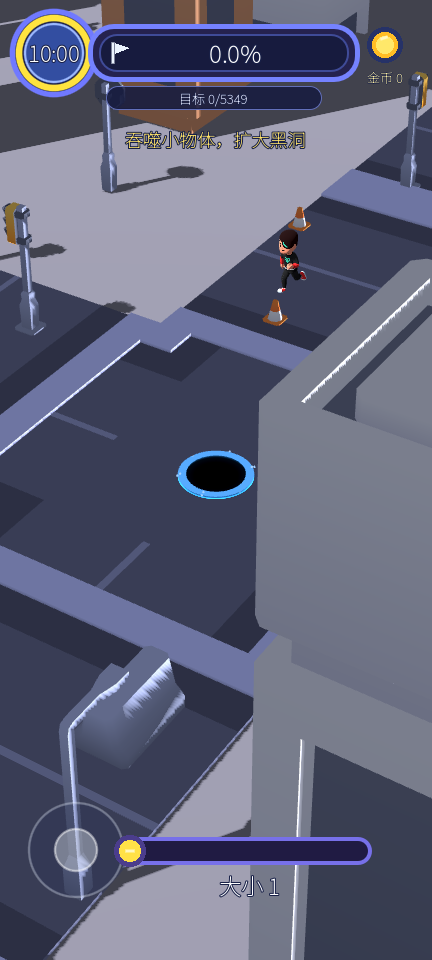
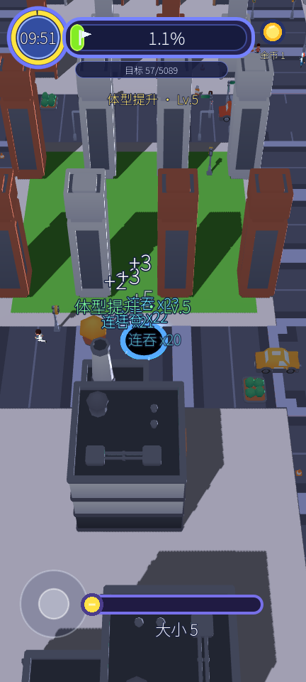
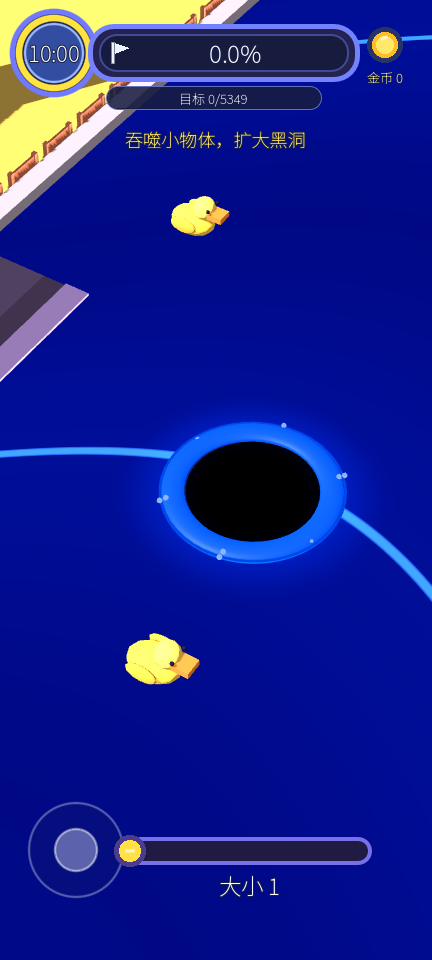
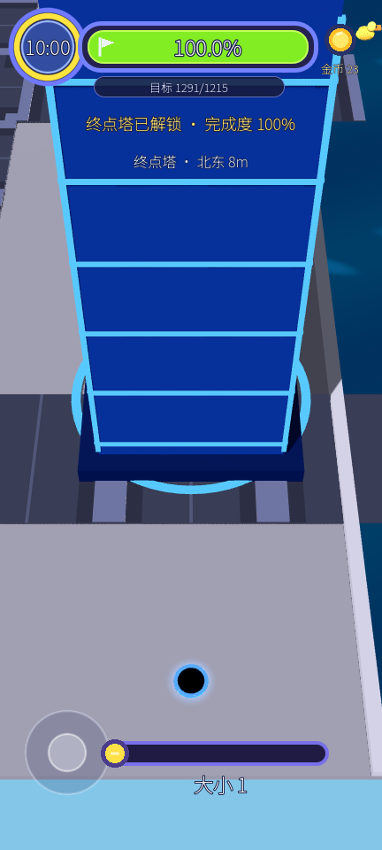
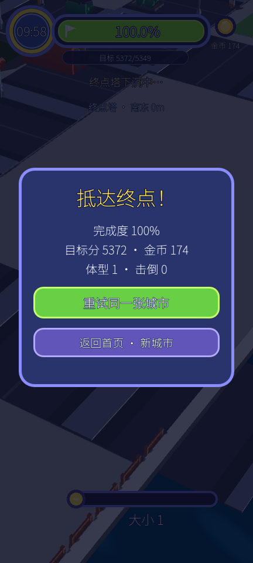

# Blackhole City

Godot 4.7.2 + GDScript 的实时 3D 黑洞吞噬单局原型。包含随机城市、19 级成长、4 个路线对手、金币与完成度、最终深蓝终点塔、胜负结算、暂停、同图重试和首页新城市。当前完成 Mac 竖屏原型，抖音适配后置。

## 游戏截图

| 城市与黑洞 | 成长反馈 | 水面与鸭子 | 深蓝终点塔 | 抵达终点 |
| :---: | :---: | :---: | :---: | :---: |
|  |  |  |  |  |

以上均为真实 Godot 渲染的 432×960 竖屏截图。

## 在线 Web 演示

**[打开 GitHub Pages 演示](https://adrianandroid.github.io/godot-blackhole-io/)** · [单独打开游戏画面](https://adrianandroid.github.io/godot-blackhole-io/play.html)

- **Mac 桌面端是主开发与验收环境**：功能开发、完整对局、故障重放、真实视觉回归和性能采样均以 Mac 结果为准。
- **GitHub Pages 是独立衍生的 Web 演示**：由 GitHub Actions 从同一源码导出，不替代 Mac 验收，也不改变桌面端玩法规则。
- 浏览器需要支持 WebGL 2；首次打开的核心 WASM、PCK 与 JavaScript 原始约 41.2 MB，gzip 后约 11.5 MB（以服务端压缩为准）。中文字体子集保留全部运行字符和可变字重，不降低画质。网页性能和渲染效果取决于浏览器与设备。

## Mac 桌面端运行（主开发）

```bash
/usr/local/bin/godot --path .
```

- 鼠标左键或单指拖动：浮动摇杆移动。
- Esc：暂停/继续。
- C：切换透视/正交，不影响玩法。
- M：静音。

普通物体必须严格小于黑洞有效半径。普通目标达到 75% 目标分后解锁终点塔；终点塔完全下沉即胜利，无需淘汰对手或达到满级。单局 10 分钟。

## 完整自动验收

```bash
python3 -I tools/acceptance.py
```

无需手工试玩。入口串联逻辑与 100 种子、完整胜负对局、20 局 soak、双投影真实截图、故障重放、性能采样和素材授权审计。任一必需组失败返回非零。

结果见：

- `artifacts/acceptance/summary.md`
- `artifacts/acceptance/summary.json`
- `artifacts/visual/regression/`
- `artifacts/performance/report.json`

详细命令、输入/镜头调试、显式基线更新和故障重放见 [`docs/DEVELOPMENT.md`](docs/DEVELOPMENT.md)。

## 目录

- `scenes/`：应用与对局场景。
- `scripts/`：核心状态、玩法、渲染与界面。
- `config/`：成长和模型等数据配置。
- `assets/game/`：正式使用且授权可追溯的资源。
- `assets/candidates/`：原始候选包；解压目录不进入 Git，也不由 Godot 导入。
- `tests/`：逻辑、整局、故障、性能与图形自动测试。
- `tools/acceptance.py`：Mac 统一验收入口；`tools/web_smoke.py` 为真实 Chrome Web 冒烟测试；`tools/subset_font.py` 可复现生成并校验运行字体子集。
- `export_presets.cfg`：无多线程 Web 导出预设。
- `web/index.html`：Pages 介绍页；实际 Godot 页面为 `play.html`。
- `.github/workflows/pages.yml`：Web 构建及独立 `gh-pages` 分支自动发布。
- `artifacts/`：本地自动验收输出，不进入 Git；`build/` 为本地导出目录，同样不提交。
- `openspec/changes/add-video-referenced-mvp/`：本轮需求、设计和任务。

## 验证边界

Mac 验收不证明抖音兼容性；截图回归不等于主观美术完全复刻；音效资源与事件测试不替代听感评审。当前 Mac 采用 OpenGL Compatibility，避开本机 Intel UHD 630 / MoltenVK 的 compute pipeline 驱动错误；实际渲染日志和性能采样保留在报告中。
