# 候选素材预览

这些图片用于审核素材风格，**全部为候选，尚未批准导入游戏**。来源、版本、许可证和校验值见 [素材清单](../ASSET_MANIFEST.md)。

建议先查看 Commercial 的示例与两种配色，再查看 Roads。图片均为官方预览的副本；原始压缩包和完整文件位于 `assets/candidates/`。

## 1. 商业建筑：优先审核

### 城市场景示例

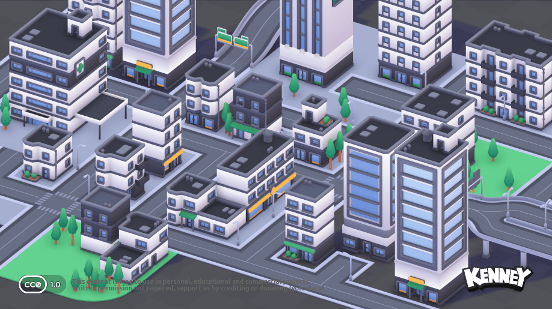

### 官方封面／默认配色

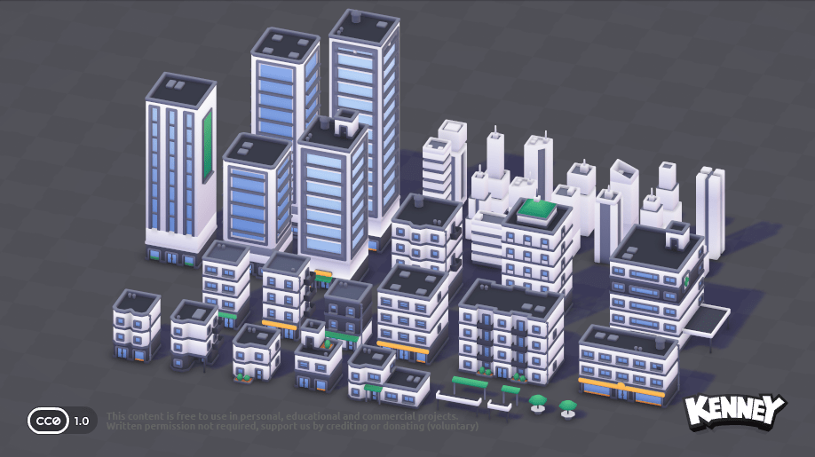

### 配色变体 A

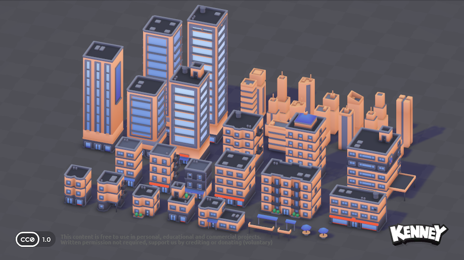

### 配色变体 B

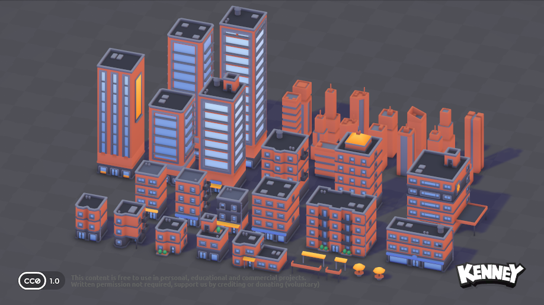

单栋建筑的透明 PNG 预览还可在以下目录逐张查看：

`assets/candidates/city-kit-commercial/extracted/Previews/`

## 2. 道路与街道设施：优先审核

### 道路场景示例

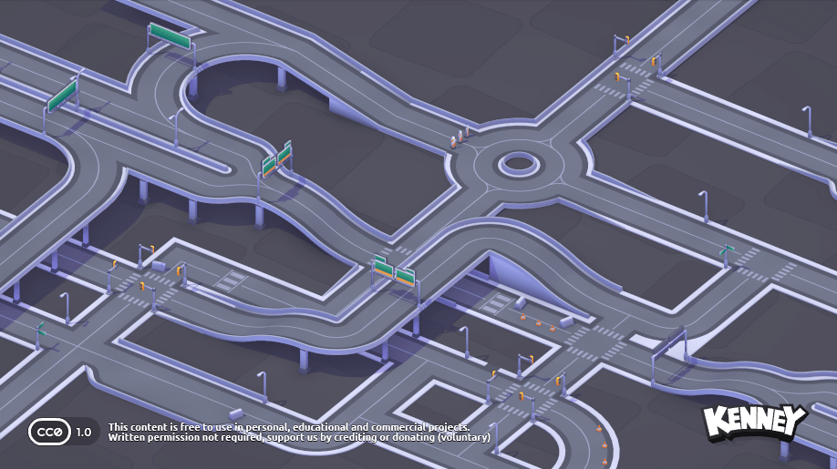

### 官方内容总览

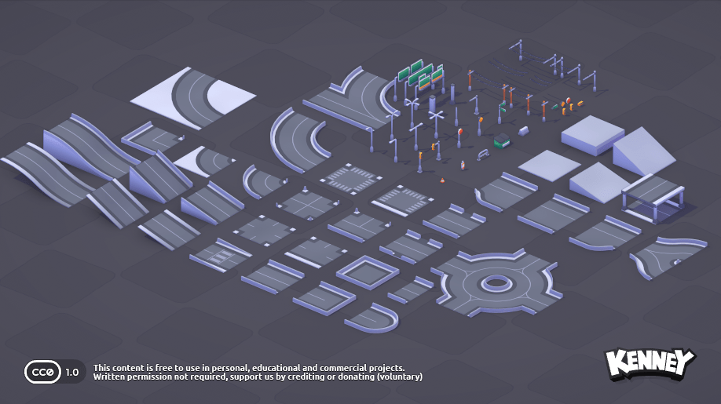

## 3. 低层住宅区：可选

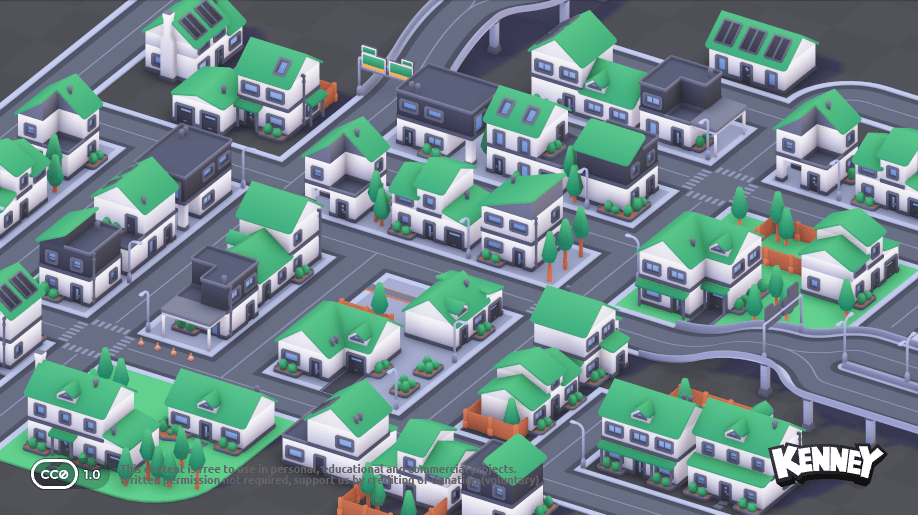

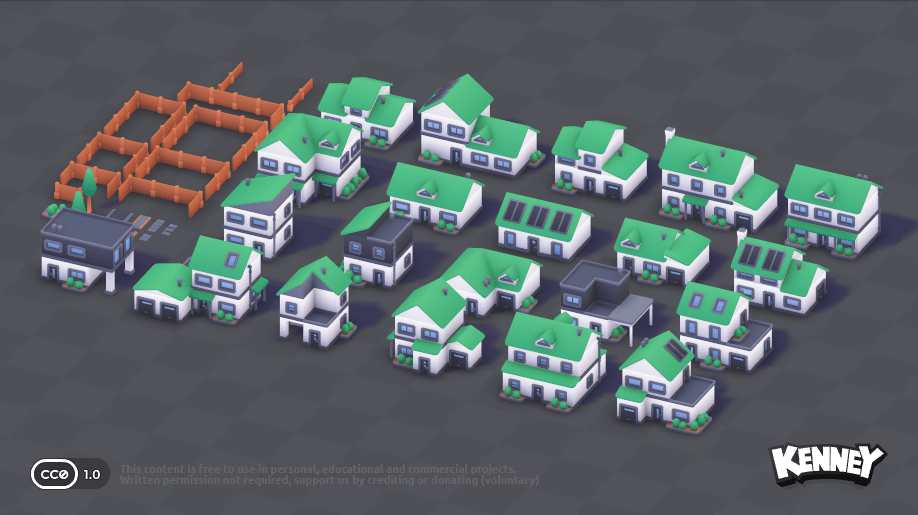

## 4. 工业区：可选

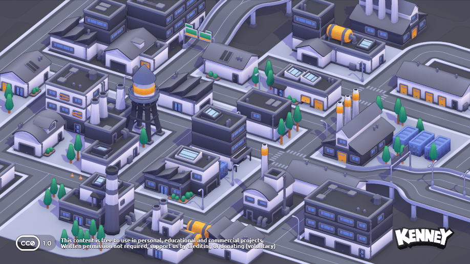

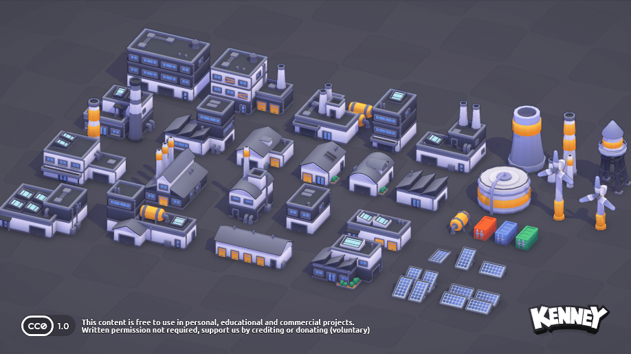

## 5. UI 组件：候选基础，不代表最终界面

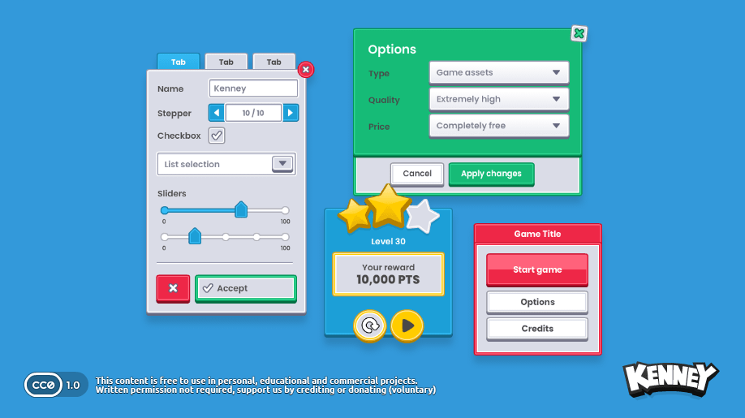

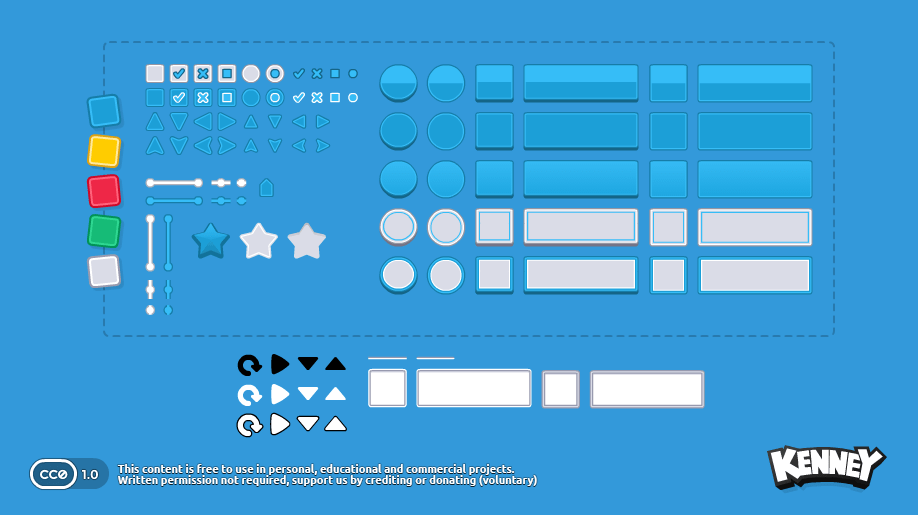

## 6. Tiny Town：仅作风格对比

这是纯俯视像素风，与已确定的斜俯视 2.5D 主方向不一致。

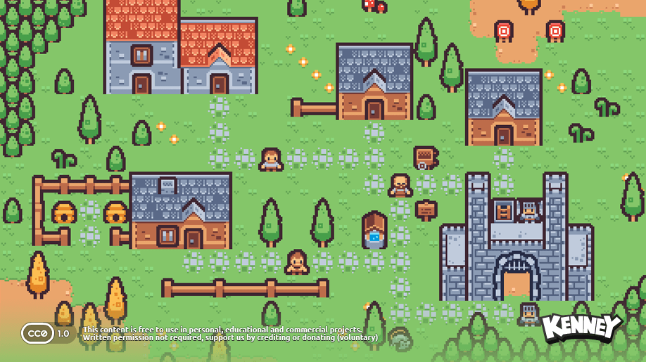

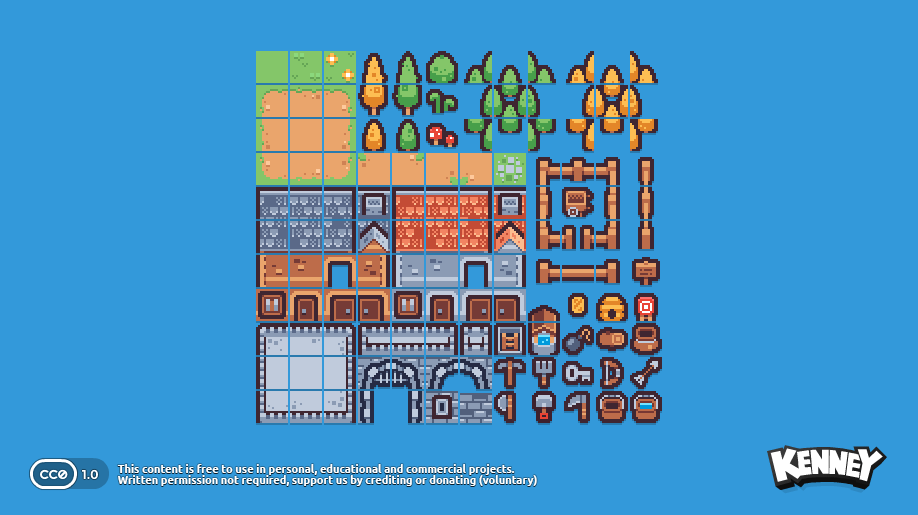
